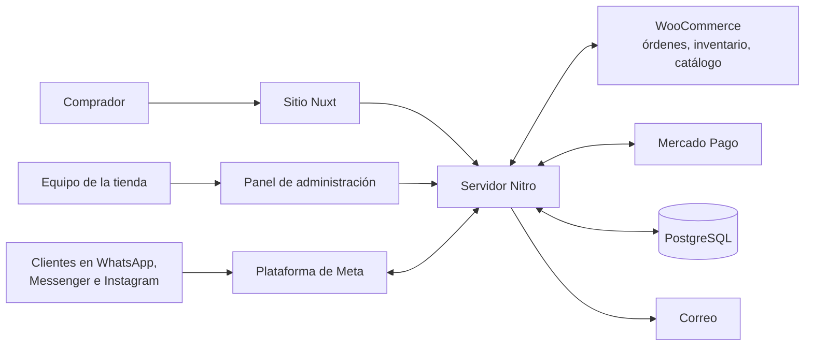
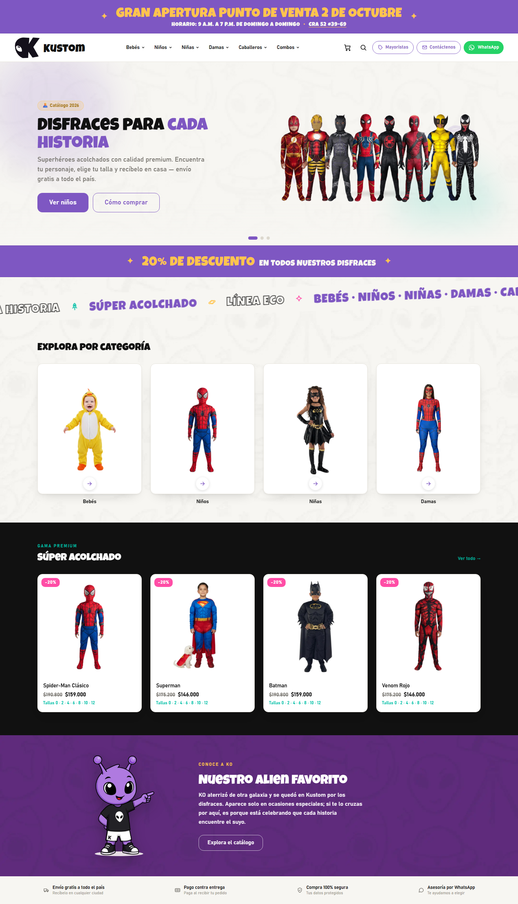
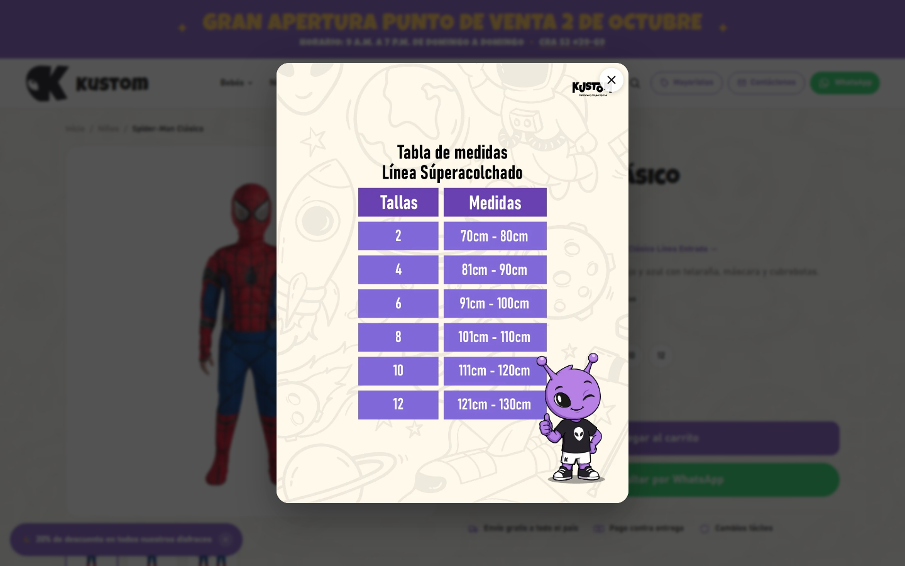
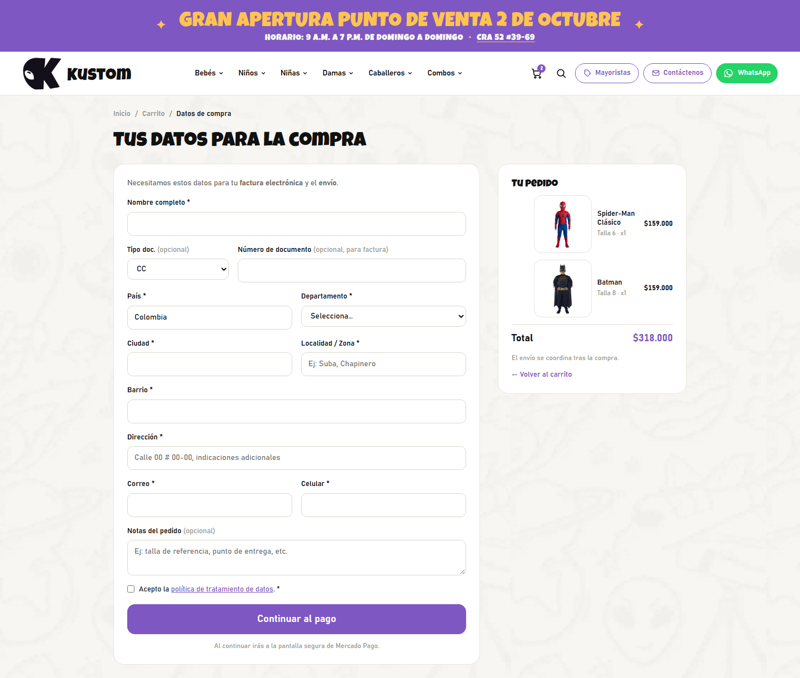
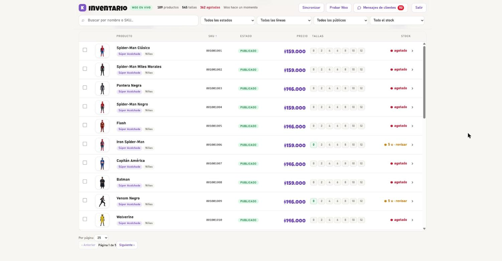
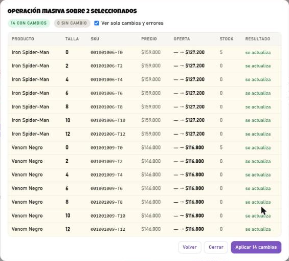
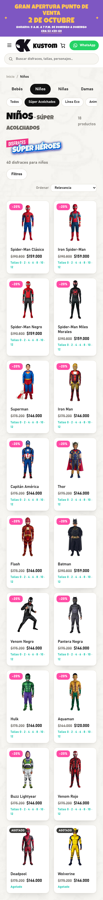

# Tienda en línea de disfraces — Kustom Disfraces

Caso de estudio de la tienda en línea de **Kustom Disfraces**, un negocio de disfraces de Bogotá
(Colombia), en producción en [disfraceskustom.com](https://www.disfraceskustom.com).

Es un frontend *headless* en Nuxt 4 que usa WooCommerce para las órdenes y el inventario y que,
además del catálogo y el pago en línea, incluye las herramientas con las que el equipo de la
tienda opera el día a día: un bot de ventas para WhatsApp, Messenger e Instagram, una bandeja para
atender esas conversaciones y un panel de inventario.

> **Sobre el código.** El código fuente es privado porque pertenece a un cliente. Este repositorio
> documenta el producto, su arquitectura y las decisiones técnicas. Puedo mostrar el código en una
> revisión técnica a solicitud.

## Funcionalidades

**Tienda**

- Catálogo navegable por público y subcategoría, con buscador, ficha de producto con galería,
  selector y guía de tallas, y productos relacionados.
- Carrito (Pinia) y checkout con datos de envío validados en el navegador y otra vez en el servidor.
- Pago con Mercado Pago (Checkout Pro) y, como alternativa, cierre del pedido por WhatsApp.
- Promociones por fecha versionadas en un archivo JSON: el servidor decide con su propio reloj si
  están vigentes, y el mismo cálculo de precio se usa en la web, el bot, el checkout y los correos.
- Productos y tallas agotadas visibles pero no comprables, en el sitio, el bot y el checkout. Hoy
  se marcan desde la configuración; con el adaptador de inventario de WooCommerce salen del stock
  real.
- Formularios de ventas al por mayor y de PQRS con envío por correo, páginas de contenido, sitemap
  y Meta Pixel opcional.

**Pagos**

- El precio nunca se toma del navegador: el servidor lo recalcula por SKU y rechaza el pago si no
  coincide con el que vio el comprador.
- El precio cobrado queda anclado en la preferencia de pago, así la orden refleja lo que se pagó
  aunque una promoción termine antes de que llegue la notificación.
- El webhook no confía en el cuerpo de la notificación: consulta el estado real del pago en la API
  de Mercado Pago. Admite además la verificación de la firma `x-signature`.
- Una sola orden en WooCommerce por pago, garantizada por una llave primaria en Postgres, porque
  Mercado Pago envía varias notificaciones casi simultáneas por cada pago.
- Si WooCommerce falla, el pago no se pierde: queda registrado, se avisa por correo al equipo de
  ventas y el webhook responde con un error para que Mercado Pago reintente.

**Bot de ventas (WhatsApp, Messenger e Instagram)**

- Menús con botones y listas sobre la plataforma de Meta, con un mismo motor para los tres canales.
- Búsqueda de productos tolerante a errores de escritura (trigramas, distancia de edición y
  comparación fonética), ficha con precio y tallas disponibles, sugerencia de talla por edad o
  estatura y enlace directo a la compra.
- Paso a atención humana, lista de espera para productos agotados y registro de las búsquedas sin
  resultado como indicador de demanda.
- Verificación de la firma de Meta (`X-Hub-Signature-256`) calculada sobre el cuerpo crudo de cada
  webhook.

**Administración**

- Bandeja de conversaciones: historial de los tres canales, medios recibidos (fotos, audios,
  documentos, ubicación), envío de texto e imágenes, tomar o devolver la conversación al bot,
  archivado y aviso de la ventana de 24 horas de WhatsApp.
- Panel de inventario: precio y stock por talla, filtros, edición masiva con vista previa de
  "antes y después", exportación e importación en Excel o CSV, carga de imágenes y registro de quién
  cambió qué.
- Alertas de stock bajo por correo y avisos al equipo cuando un cliente pide atención humana.

## Tecnologías

| Capa | Tecnología |
|---|---|
| Framework | Nuxt 4.4 (Vue 3.5, Nitro), TypeScript |
| Estado e interfaz | Pinia 3, VueUse, `@nuxt/image`, `@nuxt/fonts`, CSS con variables nativas (sin framework de estilos) |
| Base de datos | PostgreSQL serverless |
| Comercio | WooCommerce (API REST `wc/v3`) como backend de órdenes e inventario y origen opcional del catálogo |
| Pagos | Mercado Pago Checkout Pro |
| Mensajería | WhatsApp Cloud API, Messenger e Instagram (Meta Graph API) |
| Correo e imágenes | Nodemailer (SMTP), sharp |
| Despliegue | Vercel (funciones serverless y tareas programadas diarias) |

## Arquitectura

El navegador habla solo con los endpoints del propio sitio. El servidor de Nuxt (Nitro) es el
único que conoce las llaves de WooCommerce, Mercado Pago, Meta y SMTP, y es quien decide precios,
stock y estado de los pagos.

Decisiones principales:

- **Servidor como intermediario.** Las llaves viven solo en la configuración de servidor; la de
  lectura y la de escritura de WooCommerce están separadas.
- **Catálogo con dos orígenes.** Por defecto, un JSON versionado en el repositorio; como
  alternativa, WooCommerce a través de un proxy con caché de dos minutos y respaldo en el JSON
  local si la tienda no responde. Un script compara ambos orígenes antes de cambiar.
- **Inventario con adaptador.** El panel trabaja contra una interfaz con dos implementaciones:
  `mock` guarda los cambios en Postgres sin tocar la tienda y `woo` escribe en WooCommerce, con
  guardas y relectura del valor en vivo antes de escribir.
- **Lógica de pago separada del borde HTTP.** El procesamiento del webhook recibe sus dependencias
  (Mercado Pago, WooCommerce, correo) por parámetro y se prueba con dobles.

El detalle, con diagramas de cada flujo y las decisiones de seguridad, está en
[docs/arquitectura.md](docs/arquitectura.md).

## Pruebas

No hay un ejecutor de pruebas: las pruebas son scripts de Node. Cubren, entre otros, la firma de
los webhooks de Meta, las respuestas del bot, las guardas de escritura en WooCommerce, la
concurrencia del webhook de pagos y que los logs no contengan datos personales. Los scripts que
escriben datos se niegan a ejecutarse contra una base que no esté marcada explícitamente como base
de pruebas.

## Capturas

Tomadas del sitio en producción. Las del bot y la bandeja de conversaciones están pendientes; la
lista completa está en [docs/capturas/README.md](docs/capturas/README.md).

**Página de inicio**

**Ficha de producto con la guía de tallas abierta**

**Datos de compra con el resumen del pedido**

**Panel de inventario**

Conectado a WooCommerce en la etapa de solo borradores, con el estado de stock por talla.

**Vista previa de una operación masiva**

Antes y después de cada talla, mostrado antes de aplicar. La operación de la imagen no se aplicó.

**Listado de una categoría en móvil**

## Estado del proyecto

El sitio está en producción y lo usa el equipo de la tienda. Por partes:

| Parte | Estado |
|---|---|
| Tienda, checkout y pago con Mercado Pago | En producción |
| Bot de ventas y bandeja de conversaciones | En producción |
| Catálogo desde WooCommerce | Construido; por defecto el catálogo sale del JSON local |
| Panel de inventario | Usa por defecto el adaptador de simulación; la escritura directa en WooCommerce está construida y se habilita por etapas (solo borradores o una lista de productos permitidos) |
| Imágenes de producto servidas desde WooCommerce | Construido; por defecto las imágenes se sirven desde el propio sitio |
| Agotados según el stock real | Depende del adaptador de inventario: con el de simulación se marcan desde la configuración |
| Lista de deseos | Interfaz oculta; falta la persistencia |

Próximos pasos:

- Habilitar la escritura de inventario en WooCommerce para todo el catálogo.
- Registrar las compras desde el servidor con la Conversions API de Meta.
- Incorporar un ejecutor de pruebas e integración continua.

## Autor

Juan Diego Vargas — [github.com/JuanchoVargas](https://github.com/JuanchoVargas)

Proyecto desarrollado para Kustom Disfraces. La marca, el catálogo y las fotografías de producto
pertenecen a su propietario.
