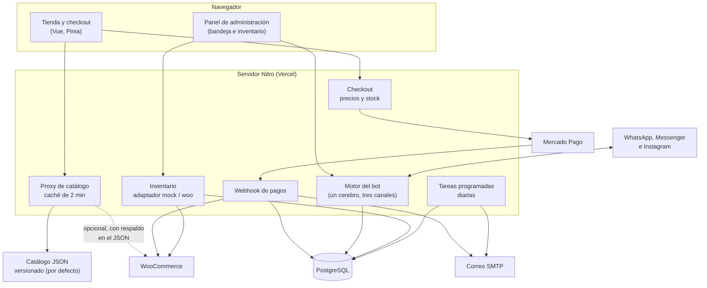
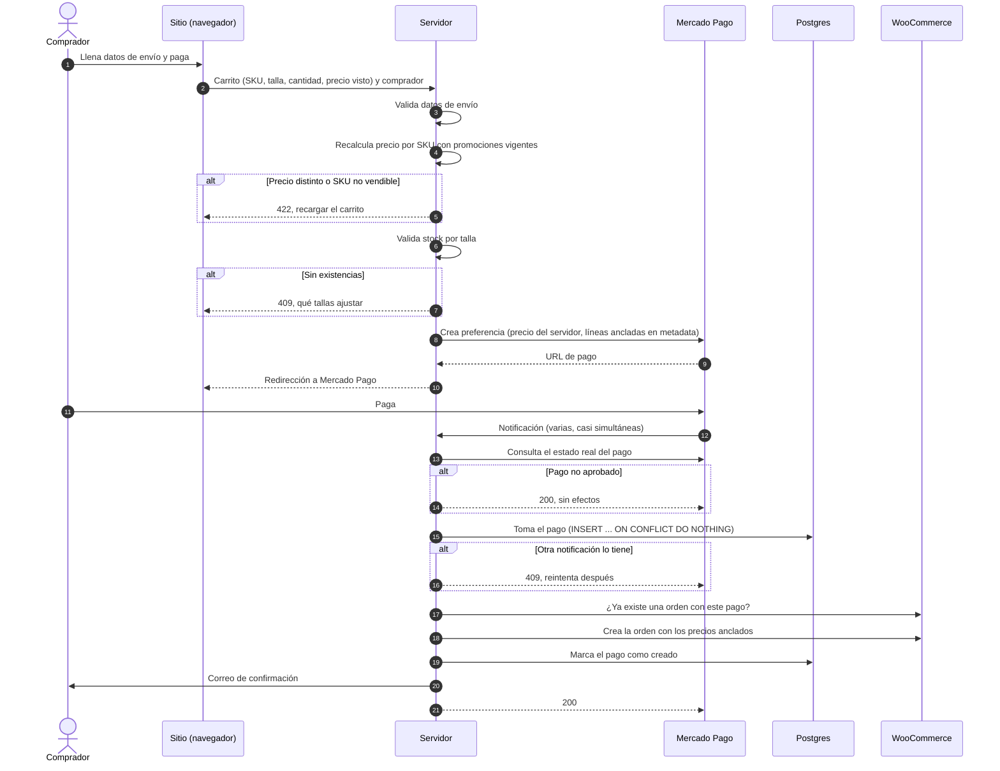
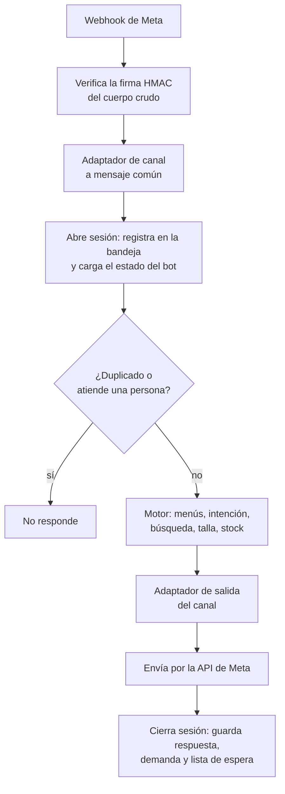
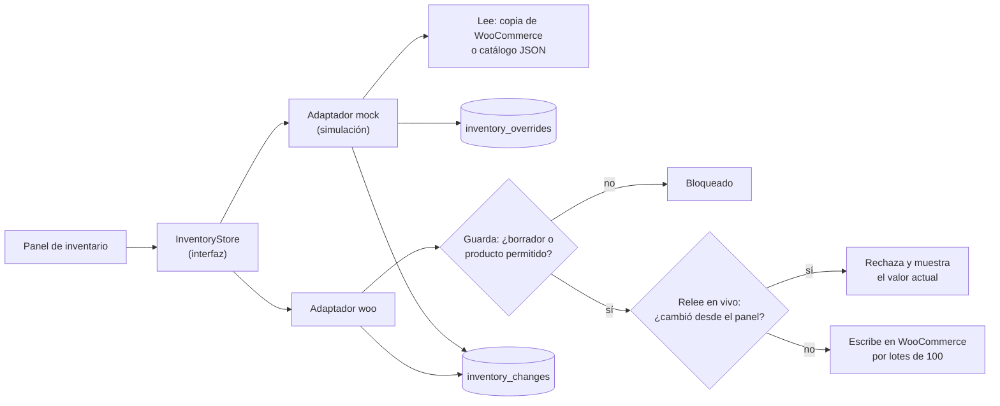

# Arquitectura

Este documento describe cómo está construida la tienda: los componentes, el flujo de compra y
pago, el bot de ventas, el inventario y las decisiones de seguridad. El código es privado; aquí se
explica el diseño sin reproducirlo.

## Componentes

La aplicación es un único proyecto Nuxt 4 desplegado en Vercel. La interfaz (Vue) y el servidor
(Nitro, en funciones serverless) comparten tipos y utilidades. WooCommerce es el backend de
órdenes e inventario y origen opcional del catálogo; Postgres guarda lo que WooCommerce no modela: conversaciones, inventario
en simulación, el candado de pagos y la demanda del bot.

| Carpeta | Contenido |
|---|---|
| `app/` | Interfaz: páginas de la tienda, checkout, contenido y administración; componentes; carrito (Pinia); catálogo, navegación y promociones en JSON |
| `server/api/` | Endpoints: catálogo, checkout, webhooks, bandeja, inventario y tareas programadas |
| `server/utils/` | Lógica de negocio: bot, pagos, inventario, correo, base de datos, logs |
| `server/middleware/` | Corte temprano de rutas que piden los escáneres automáticos |
| `shared/` | Tipos y utilidades comunes a cliente y servidor (precios, promociones, tallas) |
| `scripts/` | Pruebas, respaldos y utilidades de operación |

### Modelo de datos en Postgres

El esquema se crea de forma idempotente (`CREATE TABLE IF NOT EXISTS`, `ADD COLUMN IF NOT EXISTS`)
la primera vez que el servidor lo necesita. Los productos y las órdenes viven en WooCommerce.

| Tabla | Contenido |
|---|---|
| `conversations`, `messages`, `media` | Conversaciones por canal, mensajes y archivos recibidos |
| `inventory_snapshot`, `inventory_overrides`, `inventory_changes` | Copia de lectura de la tienda, cambios en simulación y bitácora de cambios con su autor |
| `pagos_mp` | Candado de una orden por pago (sin datos del comprador) |
| `stock_espera`, `bot_busquedas_fallidas` | Lista de espera por producto y búsquedas del bot sin resultado |

### Catálogo con dos orígenes

El catálogo se lee de un JSON versionado en el repositorio (el origen por defecto) o de
WooCommerce, según configuración.
Con WooCommerce, el servidor actúa como proxy: convierte los productos al esquema interno y los
guarda en caché dos minutos, con revalidación síncrona al expirar (en serverless, la revalidación
en segundo plano moría al terminar la respuesta). Si WooCommerce no responde, se sirve el catálogo
local y se registra el incidente: el sitio no se cae por la API. Un script compara ambos orígenes
(productos visibles, precios y tallas) antes de cambiar de uno a otro.

## Flujo de compra y pago

Puntos de diseño:

- **El precio lo decide el servidor.** El endpoint de checkout ignora el precio que manda el
  navegador; lo usa solo para detectar una diferencia y rechazar el pago con `price_mismatch`. El
  precio real sale del mismo catálogo que consume el sitio, con las promociones por fecha
  calculadas con el reloj del servidor.
- **Datos de envío validados en el servidor.** Sin ellos no se crea la preferencia; viajan a la
  orden a través de la metadata de la preferencia.
- **Precio anclado.** La preferencia guarda, por línea, el precio que se cobró y la promoción que
  aplicó. El webhook usa esos precios para la orden en lugar de recalcular: si una promoción
  termina entre el pago y la notificación, la orden sigue reflejando lo que el cliente pagó. Si
  los montos no cuadran, la orden queda marcada para ajuste manual y se avisa a ventas.
- **Prueba en seco.** El checkout acepta un modo que recorre todo el camino (comprador, precios,
  stock, armado de la preferencia) y se detiene antes de llamar a Mercado Pago. El mismo modo, sin
  comprador, sirve para cotizar el carrito con los precios vigentes.
- **Una sola orden por pago.** Mercado Pago envía varias notificaciones por pago y llegan como
  invocaciones en paralelo; buscar la orden antes de crearla no basta, porque dos invocaciones
  consultan antes de que ninguna haya creado. Decide la llave primaria de `pagos_mp`: la invocación
  que inserta la fila es la dueña del pago. La fila pasa por `procesando`, `creada` o `fallida`; una
  `fallida`, o una `procesando` abandonada, se puede retomar. La búsqueda en WooCommerce queda como
  segunda barrera para pagos anteriores a la tabla.
- **El pago no se pierde.** Sin base de datos, el webhook no toca WooCommerce: responde 503 para
  que Mercado Pago reintente y avisa por correo al equipo de ventas. Con WooCommerce caído, la fila
  queda `fallida`, se avisa igual con lo necesario para recuperar el pedido y la respuesta 503
  provoca el reintento.
- **Lógica separada del borde HTTP.** El handler del webhook solo recibe la notificación y
  arma las dependencias reales (Mercado Pago, WooCommerce, correo). La lógica recibe esas dependencias por
  parámetro, así que la carrera entre notificaciones se prueba con dobles contra una base de
  pruebas, sin un "modo simulación" en el camino de producción.

## Bot de ventas

Un mismo motor atiende WhatsApp, Messenger e Instagram. Cada canal tiene un adaptador que convierte
el webhook de Meta en un mensaje común y la respuesta del motor en el formato del canal (botones y
listas en WhatsApp, respuestas rápidas en Messenger).

- **Búsqueda tolerante a errores.** Normaliza el texto (minúsculas, sin tildes) y puntúa cada
  producto visible contra nombre, slug y una tabla de alias, combinando distancia de edición
  acotada, similitud por trigramas y una clave fonética. Es determinista y se prueba sin red.
- **Sugerencia de talla.** El bot pregunta edad o estatura y propone una talla.
- **Stock en las respuestas.** Antes de responder se refresca el estado de existencias (los
  agotados marcados desde la configuración o, con el adaptador de WooCommerce, el stock real): la
  ficha muestra solo tallas disponibles y un producto agotado ofrece la lista de espera.
- **Demanda.** Las búsquedas sin resultado se guardan como indicador de qué piden los clientes.
- **Paso a atención humana.** Con la conversación en manos de una persona del equipo el bot calla.
  Si el cliente pidió atención y nadie lo ha tomado, una palabra de reinicio le devuelve el bot; si
  nadie atiende en un tiempo, la conversación vuelve sola al bot. El equipo recibe un aviso por
  correo cuando un cliente pide atención.
- **Reintentos de Meta.** Cada mensaje entrante se identifica por su id de Meta, con índice único
  en la base: un reintento de un mensaje ya respondido, o que se está respondiendo, no genera una
  segunda respuesta.

### Bandeja de conversaciones

La bandeja muestra las conversaciones de los tres canales con sus medios. Los archivos recibidos se
guardan en Postgres y se sirven por un token aleatorio de 128 bits, porque Meta necesita descargar
esa URL para reenviar imágenes; tienen retención limitada y una tarea diaria borra los antiguos. Otra
revisión, diaria y también al abrir la bandeja, avisa por correo de las conversaciones de WhatsApp
atendidas por una persona cuya ventana de 24 horas está por vencer sin respuesta.

## Inventario con adaptador

El panel de inventario y el resto del servidor hablan con una sola interfaz (`InventoryStore`:
listar, consultar, cambiar precio, cambiar stock, operación masiva). La implementación se elige por
configuración y ambas devuelven la misma forma de datos y registran cada escritura en la bitácora
`inventory_changes`.

- **`mock`** lee los productos reales (copia de WooCommerce con la llave de solo lectura, o el
  catálogo JSON) y guarda los cambios en Postgres, aplicados encima de lo leído. Los cambios no
  llegan a la tienda; cuando se cambia de adaptador se aplican con una vista previa.
- **`woo`** escribe en la API REST de WooCommerce, agrupando por producto en lotes de 100. Tiene
  dos protecciones:
  - una **guarda de validación**, activa por defecto: solo escribe en borradores y en una lista de
    productos permitidos, para habilitar la escritura real por etapas;
  - **releer antes de escribir**: el panel muestra una copia y WooCommerce descuenta cada venta;
    antes de escribir se lee la variación en vivo y, si el stock o el precio cambiaron, no se
    escribe y la fila se actualiza con el valor real. Así un ajuste no sobrescribe una venta
    ocurrida entretanto.
- **Edición masiva** con vista previa: una operación devuelve, por talla, el valor antes y después
  sin escribir nada; luego se aplica.
- **Excel y CSV**: exportación e importación del inventario por talla.
- **Autoría**: cada cambio registra quién lo hizo, a partir de una lista fija de nombres del equipo.
- **Alertas de stock bajo**: cuando una talla cruza el umbral hacia abajo se envía un correo, y una
  tarea diaria repite la revisión.

## Decisiones de seguridad

| Decisión | Cómo se implementa |
|---|---|
| Llaves solo en el servidor | Toda credencial (WooCommerce, Mercado Pago, Meta, SMTP, base de datos) está en la configuración de servidor, fuera de la configuración pública (`runtimeConfig.public`); nunca se serializa al navegador |
| Mínimo privilegio en WooCommerce | Llave de solo lectura para el catálogo y llave de escritura separada para órdenes e inventario |
| Precio y stock decididos en el servidor | Recalculo por SKU, rechazo si el precio enviado no coincide, validación de stock y de datos de envío antes de crear el pago |
| Webhook de pagos verificado | No se confía en el cuerpo del webhook: el estado del pago siempre se consulta en la API de Mercado Pago. Admite además la verificación de la firma `x-signature` (HMAC-SHA256, comparación en tiempo constante) |
| Idempotencia de pagos | Llave primaria en `pagos_mp` como candado y búsqueda en WooCommerce como segunda barrera |
| Webhooks de Meta firmados | Cabecera `X-Hub-Signature-256` verificada con HMAC-SHA256 sobre el cuerpo crudo, tal como llegó, nunca sobre el JSON re-serializado, y comparada en tiempo constante; el JSON se lee de esos mismos bytes ya verificados |
| Panel de administración | Acceso del equipo con sesión en cookie `httpOnly`, `secure` y `SameSite=Lax`, firmada con HMAC y con vencimiento. Cada endpoint de bandeja e inventario exige la sesión en el servidor |
| Tareas programadas | Exigen `Authorization: Bearer` con un secreto comparado en tiempo constante; sin el secreto configurado responden 401 |
| Logs sin datos personales | Los identificadores de clientes se enmascaran (solo los últimos 4 caracteres), los números largos se redactan en textos de error y los payloads de los webhooks se registran, si acaso, solo como estructura (claves y tipos), con un interruptor apagado por defecto. Los errores de Mercado Pago y WooCommerce se limpian de credenciales antes de registrarse |
| Medios de la bandeja | URL con token aleatorio de 128 bits, `X-Content-Type-Options: nosniff`, `X-Robots-Tag: noindex` y retención limitada |
| Ruido de escáneres | Un middleware responde 404 de texto plano, antes de la aplicación, a rutas que el sitio no tiene (`*.php`, `/wp-*`, `/.env`, `/.git/*`, `/cgi-bin/*`) |
| Integraciones opcionales | Sin sus credenciales, cada integración responde 503 o se desactiva y el resto del sitio sigue funcionando; el pago por WhatsApp queda como alternativa |
| Pruebas que no tocan producción | Los scripts que escriben exigen una base marcada explícitamente como de pruebas (una tabla marcador que producción no tiene), en lugar de comparar cadenas de conexión |
